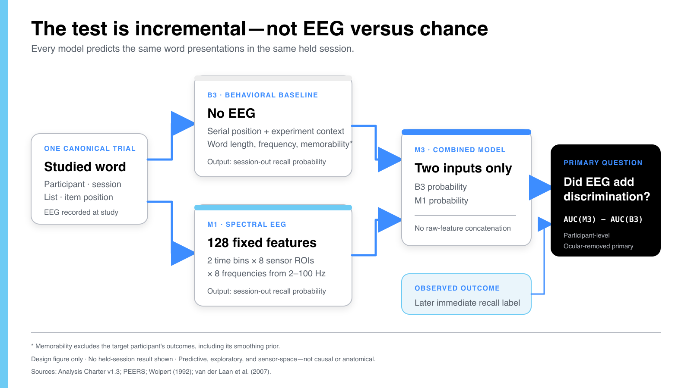
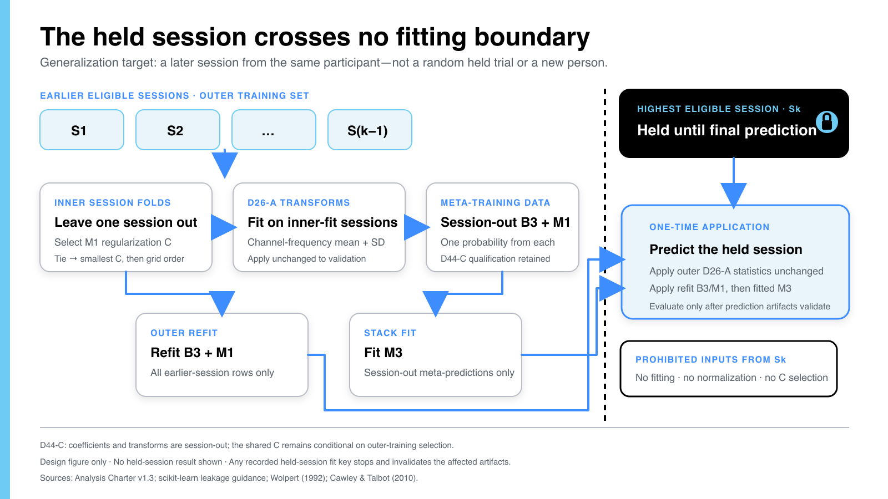
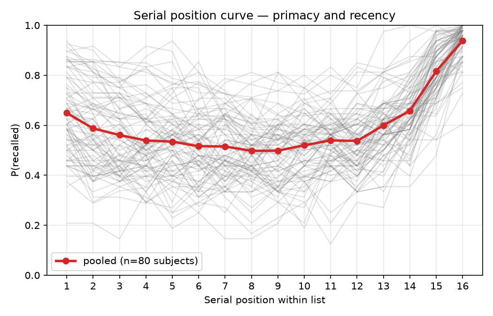
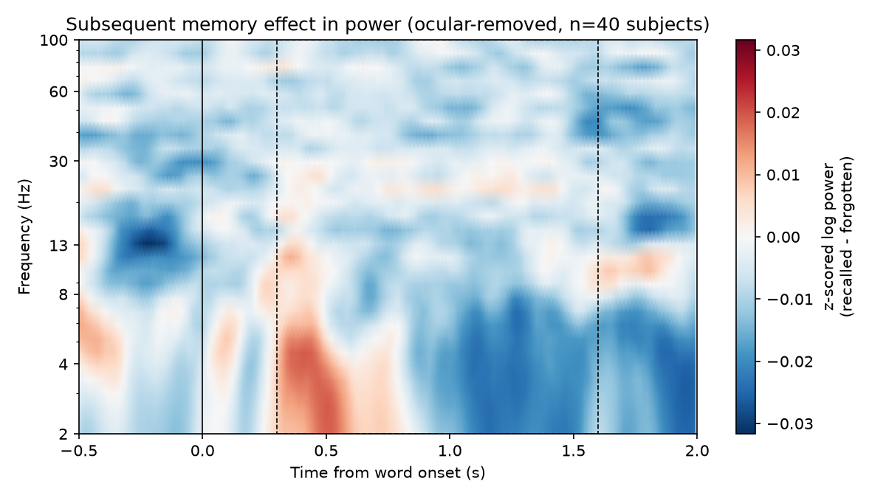
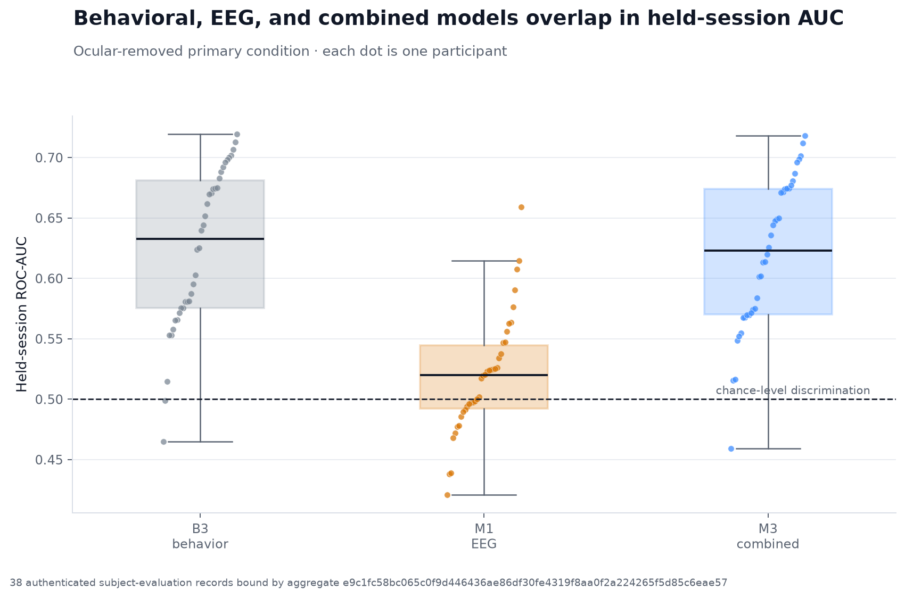
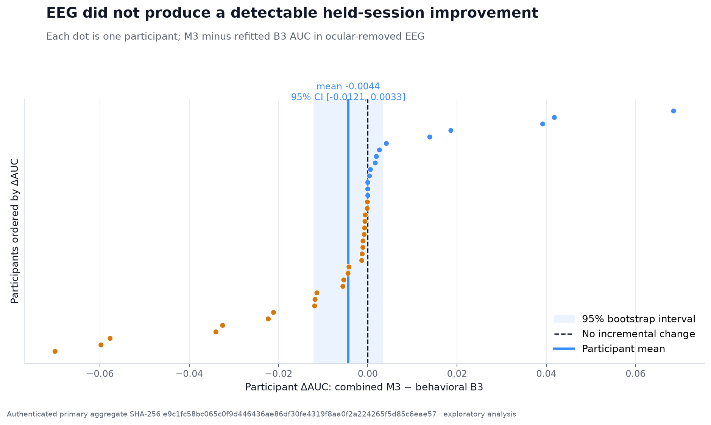

# NeuroAI

### Building a leakage-safe EEG memory prediction pipeline from real data

I developed NeuroAI to learn how a complete computational neuroscience analysis works in practice,
from defining one prediction row to validating the final model on an unseen recording session.
The project uses real free-recall EEG data from the Penn Electrophysiology of Encoding and
Retrieval Study, or PEERS.

The question was whether EEG recorded while a participant studied a word added predictive
information about later recall beyond what the word and its experimental position already
predicted. The result was secondary to the main challenge: building a valid behavioral baseline,
an interpretable EEG model, a leakage-safe combined model, and a reproducible evaluation system.

My role was to own the research question, scientific decisions, protocol teach-backs, and
interpretation. I used AI coding tools to assist with implementation, tests, and documentation,
then reviewed the scientific boundaries and traced them to the relevant source, contract, or test.



## What I built

| Model | Inputs | Purpose |
| --- | --- | --- |
| **B3 behavioral baseline** | Serial position, session and list context, word length, word frequency, and target-excluded memorability | Establish what can already be predicted without EEG |
| **M1 EEG model** | 128 spectral features from two time bins, eight scalp regions, and eight frequencies | Convert study-period EEG into a held-session recall probability |
| **M3 combined model** | Session-out B3 and M1 probabilities | Measure whether EEG changes prediction beyond B3 |

All three models use L2-regularized logistic regression. This kept the pipeline interpretable and
made the incremental comparison easier to audit than a larger end-to-end neural network.

## The data problem

One row represents one studied word. Its label records whether that same item was later recalled
during the immediate free-recall period for its list. Every row is identified by participant,
session, list, and item position, which prevents labels, EEG features, and predictions from being
joined by row order alone.

The project includes code for:

- downloading and validating PEERS event and EEG files;
- constructing item-level recall labels;
- preprocessing and epoching the EEG;
- building behavioral and spectral features;
- locking participant, trial, and fold manifests;
- fitting B3, M1, and M3;
- calculating paired held-session metrics; and
- storing and verifying provenance-bound artifacts.

## Leakage-safe evaluation

For each participant, the highest eligible session is held out for final evaluation. It does not
contribute to normalization, coefficient fitting, or hyperparameter selection.



The most important controls are:

1. EEG normalization statistics are fitted only on permitted training sessions.
2. Word memorability excludes the target participant's own recall outcomes.
3. M3 is trained on session-out B3 and M1 probabilities, not predictions from rows used to fit the
   base coefficients.
4. B3, M1, and M3 are evaluated on the same surviving trials and recall labels.
5. Cohort, feature, split, metric, and claim rules were frozen before the held-session result was
   opened.

Under the D44-C design, the M3 inputs are session-out but not fully session-cross-fitted. The
predicted inner session does not fit the coefficients or transforms used on it, but its labels can
influence the regularization value selected across the outer-training sessions.

## Research process

The analysis developed through ten stages:

1. reject an unsuitable demonstration dataset after identifying a task confound;
2. audit PEERS events and define the item-level recall outcome;
3. build the behavioral baseline before adding EEG;
4. preprocess ocular-removed and ocular-kept EEG conditions;
5. explore subsequent-memory spectral patterns;
6. freeze the analysis charter and claim ceiling;
7. generate outcome-blind participant, trial, and fold manifests;
8. build the B3, M1, and M3 artifact graph;
9. verify the stored artifacts and reproduce the full cohort from a fresh root; and
10. inspect the result only after the reproduction matched.

The [full research report](docs/REPORT.md) explains what each stage contributed, which alternatives
were rejected, and what the failures changed.

## Selected figures

The behavioral serial-position curve shows why chance was not a fair comparator. Recall already
varied systematically across the 16-word list.



The exploratory spectral analysis helped define the interpretable EEG feature space. Because the
same cohort's labels informed part of that design, the final model is explicitly exploratory.



The fitted model summaries show the behavioral baseline, EEG-only model, and combined model across
participants.



## Result in context

Across 38 participants, the primary mean held-session difference between M3 and refitted B3 was
`-0.0044`, with a 95% participant-bootstrap interval from `-0.0121` to `0.0033`. The prespecified
category was no detectable increment and imprecise.



This result does not establish equivalence or show that EEG contains no memory-related
information. It only says that the selected spectral representation did not add detectable
held-session predictive information in this exploratory pipeline.

## Code map

| Path | What it demonstrates |
| --- | --- |
| [`src/peers/events.py`](src/peers/events.py) | Item-level recall labels and canonical trial keys |
| [`src/peers/baselines.py`](src/peers/baselines.py) | Behavioral features and target-excluded memorability |
| [`src/peers/m1_feature_generation.py`](src/peers/m1_feature_generation.py) | Trial-level spectral feature generation |
| [`src/peers/m1_features.py`](src/peers/m1_features.py) | Strict train-only normalization and feature validation |
| [`src/peers/m1_model_execution.py`](src/peers/m1_model_execution.py) | B3, M1, and M3 fitting with session-out predictions |
| [`src/peers/m1_evaluation.py`](src/peers/m1_evaluation.py) | Paired metrics, participant bootstrap, and result categories |
| [`src/peers/m1_locked_orchestration.py`](src/peers/m1_locked_orchestration.py) | Fail-closed execution and provenance checks |
| [`tests/`](tests/) | Unit, integration, leakage, normalization, stacking, and artifact tests |

## Run the portable test suite

This repository does not redistribute raw EEG or participant-level prediction artifacts. The code
and synthetic contract tests run without those files:

```bash
uv sync --locked --all-groups
uv run pytest -q
```

Set `NEUROAI_DATA_ROOT` to a local PEERS data directory to run the data-dependent integration
checks and analysis scripts. See [GETTING_STARTED.md](GETTING_STARTED.md) for the data layout and
workflow.

The aggregate result table is accompanied by a
[public provenance record](results/provenance.json) that binds it to the frozen scientific code,
verified run, reproduction comparison, and source result records without exposing participant
data or local execution paths.

## Scientific boundary

This is an exploratory within-participant, held-session analysis. It does not establish causality,
a neural encoding mechanism, cortical localization, equivalence, confirmation, or transfer to new
participants. A confirmatory study would freeze the current pipeline before examining labels from
an untouched cohort.

Dataset: [Penn Electrophysiology of Encoding and Retrieval Study, OpenNeuro ds004395](https://doi.org/10.18112/openneuro.ds004395.v2.0.0).

License: [MIT](LICENSE).
