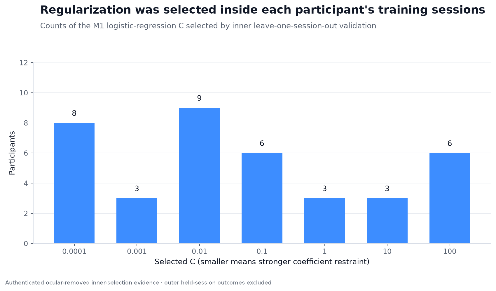
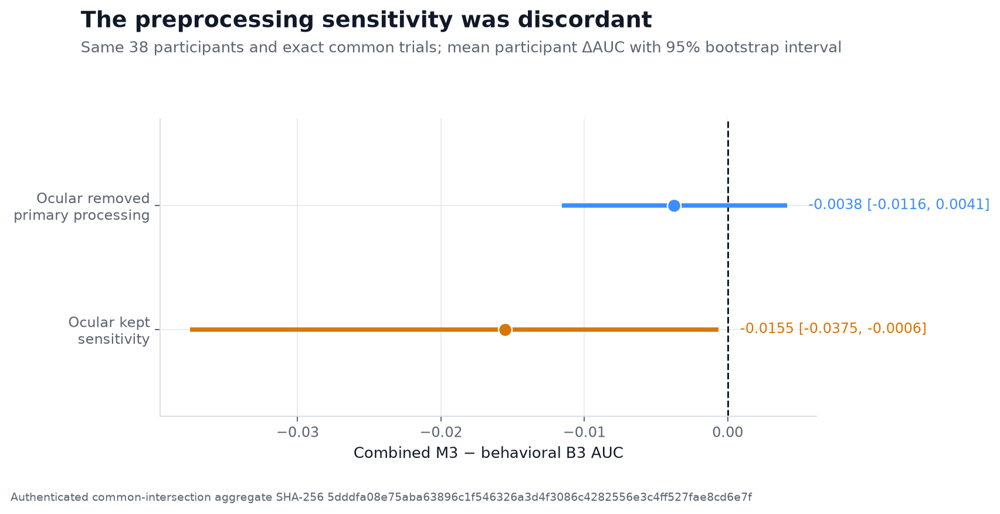

# NeuroAI

## Research question

Does spectral EEG recorded while a participant studies a word add held-session predictive
information about that word's later immediate free recall, beyond the word and its serial
position?

The fitted comparator is wider than that question names. The primary contrast is the combined
model, M3, against a refitted behavioral baseline, B3, on the same held-session trials. B3 uses
serial position, session and list context, word length, word frequency, and target-excluded word
memorability.

The dataset is the Penn Electrophysiology of Encoding and Retrieval Study (PEERS), experiment
`ltpFR`, released as
[OpenNeuro ds004395](https://doi.org/10.18112/openneuro.ds004395.v2.0.0). One row is one studied
word. The label is true only when a `REC_WORD` event with `item_num > 0` matches that
presentation on participant, session, list (`trial`), and item number. Practice lists
(`trial <= 0`), studied presentations with `sample < 0`, recognition, and final free recall do
not define the label. The canonical key is `(subject_id, session, trial, item_num)`. Serial
position is a feature and a provenance column, not a join key.

## Answer

On public PEERS data (OpenNeuro ds004395, 38 participants), study-period EEG did not add
detectable recall prediction beyond the behavioral baseline (primary M3 minus B3 delta-AUC
-0.0044, 95% participant-bootstrap interval -0.0121 to 0.0033).

The interval includes zero. The prespecified category is no detectable increment and imprecise.
No smallest-effect bound was justified, so the charter does not permit the word "equivalent" or
a strong statistical-null claim. The evaluator category for an interval that includes zero is
`no_detectable_increment__imprecise`, and the charter states that this category is not an
equivalence claim.

This result does not establish equivalence or show that EEG contains no memory-related
information. It only says that the selected spectral representation did not add detectable
held-session predictive information in this exploratory pipeline.


`results/summary.csv` stores the same primary ocular-removed contrast as mean delta-AUC
-0.0043799736 with interval -0.0121122622 to 0.0032501280 (`n_participants` 38, status
`no_detectable_increment_imprecise`). The report and the sentence above use -0.0044 and
-0.0121 to 0.0033. The descriptive mean held-session AUCs in the primary ocular-removed
condition are 0.6245 for B3, 0.5197 for M1, and 0.6202 for M3. The summary file stores
0.6245389973, 0.5196518269, and 0.6201590237, and it leaves their interval fields empty. Those
three means describe the separate models. They are not the primary test.

## Design decisions

The result was secondary to the main challenge: building a valid behavioral baseline,
an interpretable EEG model, a leakage-safe combined model, and a reproducible evaluation system.
The sections below record the estimand, the leakage paths, the split, the models, and the
interval.

### Estimand

For each participant, the primary quantity is held-session AUC(M3) minus held-session
AUC(refitted B3) on ocular-removed outer-test rows. The reported estimate is the unweighted mean
of those 38 differences. Each participant counts once. A pooled-trial AUC is not the estimand, so
participants with more surviving trials do not dominate the mean.

The primary condition is ocular-removed EEG. Ocular-kept EEG is a sensitivity condition. The
charter states that ocular-kept cannot rescue a non-positive primary result, and the evaluation
contract fixes `primary_category_unchanged_by_sensitivity` to true.

B3, M1, and M3 are L2-regularized logistic regressions. The same learner is used so the
incremental comparison stays inspectable. A neural network or a nonlinear ensemble was the
rejected alternative. `docs/RESEARCH_DECISIONS.md` gives the reason: interpretable, bounded,
and appropriate for the available participant-session structure.

| Model | Inputs | Role in the contrast |
| --- | --- | --- |
| B3 | 15 one-hot serial-position indicators, list number, session number, word length, word frequency, and leave-one-participant-out word memorability | Behavioral baseline, refit on the trials that survive the EEG pipeline |
| M1 | 128 spectral features: 2 time bins, 8 sensor-space regions, 8 frequencies | EEG-only recall probability |
| M3 | Session-out B3 probability and session-out M1 probability | Incremental stack. Raw behavioral and EEG features are not concatenated |


### Where leakage could enter

Each row below is a path that could have moved M3 minus B3 without any change in held-session
EEG information. The last column is what the repository still leaves open.

| Path | How it could move the increment | What closes it | What remains open |
| --- | --- | --- | --- |
| Join by row order after epoch rejection | A label or an EEG vector attaches to the wrong word | Canonical key `(subject_id, session, trial, item_num)`. Joins are one-to-one and fail on duplicates, missing rows, extras, or order-dependent alignment | Closed in the manifest and prediction contracts. The public tree does not include the participant-level tables |
| Wrong memory event as the label | Recognition, final free recall, practice, or an intrusion becomes the outcome | `recalled` is true only for a matched `REC_WORD` with `item_num > 0`. Practice lists and negative study samples are excluded. Final free recall and recognition do not relabel trials | The label is immediate free recall. The charter states that this outcome involves encoding and retrieval, and is not a direct measure of memory formation |
| Target participant inside word memorability | The participant's own recall enters a B3 input, including the smoothing prior | Leave-one-participant-out removes that participant from the word's recalled count, the word's total count, and the smoothing grand mean. Smoothing is 10 pseudo-observations at the other-participant mean. Synthetic tests require the feature to stay fixed when every target outcome changes | Other participants' outcomes remain in the feature. That is the memorability estimate |
| Held-session EEG in its own normalization | The held session's unlabeled spectrum sets the scale applied to itself | D26-A fits a mean and a population standard deviation (`ddof=0`) on permitted training sessions only, after `log10(power + 1e-30)`, separately for each of 40 channels and each frequency, and applies those statistics unchanged. A zero training standard deviation is replaced by 1. There is no second scaler on the 128 EEG features. Tests reject a held-session fit key | D26-B, whole-held-session batch normalization, is a prespecified transductive sensitivity. It is not the primary path, and `results/summary.csv` has no D26-B row |
| Random trial split | Nearby study events in one session appear on both sides of the split | The outer test session is the highest eligible session within the participant. It is excluded from normalization, coefficient fitting, hyperparameter selection, threshold selection, calibration, feature selection, and stopping. Inner folds leave one outer-training session out. A random trial split is not allowed | Trials inside a session remain dependent. The uncertainty method resamples participants for that reason |
| M3 trained on in-sample base probabilities | B3 and M1 probabilities from rows those models already fit are unrealistically confident, because the base models already saw those labeled rows | Every M3 training row receives B3 and M1 probabilities from coefficients and transforms that did not fit that row. Outer-test probabilities come from one refit on all outer-training rows. A missing cross-fit row, a key mismatch, or a fit hash that contains the predicted row fails the participant | Not fully closed. Under D44-C the predicted inner session is left out of the coefficients and transforms used on it, but its labels can influence the one `C` selected from the outer-training sessions. The M3 inputs are session-out but not fully session-cross-fitted |
| Different trials in B3, M1, and M3 | EEG rejection drops a different item set from one model | B3, M1, and M3 are fit and scored on the same condition-specific survivor rows. B3 is refit on those rows. The historical 78-subject B3 score is context, not the comparator | The comparison says nothing about trials the EEG pipeline rejected |
| Ocular conditions on different trials | A preprocessing difference is actually a different word set | A direct condition comparison uses the locked intersection of canonical keys | The common-trial sensitivity is discordant. See the checked alternatives below. The discordance flag does not change the primary category |
| Cohort edited after seeing AUC | Dropping or replacing participants moves the unweighted mean | Eligibility is fixed before fitting and does not use outcome performance: readable derivatives, finite samples, channel schema, at least three complete sessions, both recall classes in every fit and score partition, no replacement, and no named-subject exception. Manifests are outcome-blind | The pre-result file inventory was descriptive, not itself the frozen cohort: 40 subject directories, 38 with three sessions in both conditions, and two with one. The published primary `n` is 38 |
| Feature family or `C` grid changed after the held-session scores | A new window, frequency, region, or penalty is chosen because it produces an increment | Window, region map, 128-feature order, `C` grid, and tie rule were frozen before the held-session result was opened. Ties take the smallest `C`, then the declared grid order. There is no feature selection, PCA, learned spatial filter, or post-outcome grid expansion | Recall-labeled exploratory work on this cohort had already influenced the 2 Hz lower bound and the two-bin split. The freeze does not make that earlier choice outcome-blind. See the next subsection |
| Threshold metric after the scores | Balanced accuracy needs a cutoff. A cutoff chosen after the result is a second analysis | D42-A omits balanced accuracy. No threshold is fit or applied. IDI, continuous NRI, paired DeLong, and Brier score cannot create an alternative positive claim | Those secondary values are not in `results/summary.csv`. Their absence is not evidence about their sign |


### Held-session evaluation

The split is within participant. The highest eligible session is the outer test. Earlier eligible
sessions are the outer-training set. A subject-condition needs at least three complete sessions,
so the outer-training set has at least two sessions. Each outer partition and each inner fold
must contain both recall classes. Failure excludes that subject-condition before fitting and
records attrition.

M1's penalty `C` is chosen by the unweighted mean inner-session ROC-AUC. The candidate grid is
`[0.0001, 0.001, 0.01, 0.1, 1.0, 10.0, 100.0]`. After selection, the first-level model is refit
on every outer-training row and applied once to the outer test. B3 and M3 use fixed `C=1.0`.
B3 standardizes its inputs with a scaler fit on the permitted training rows. M1 and M3 do not
add a second scaler. M1 and M3 specify no probability calibration. The B3 contract is that
scaler followed by logistic regression, with no calibration step.

The held-session design tests later-session prediction for the same participant. It does not
test transfer to a new participant.



### Baselines and the EEG comparison

Chance is not the comparator. Recall already varies across the 16-word list, so a model that
only rediscovers serial position can beat chance without using EEG.


`src/peers/baselines.py` defines four behavioral models: B0 (base rate), B1 (serial position,
list, session), B2 (word length, word frequency, memorability), and B3 (B1 plus B2). B3 is the
frozen comparator. The public aggregate table does not report B0, B1, or B2. `scripts/run_baselines.py`
implements a separate held-last-session behavioral run; its output is not the primary M3-minus-B3
result, and the 78-subject historical B3 score remains context only.

M1 is the EEG-only model. The analysis window is 300 to 1600 ms after word onset, split at 950 ms.
`t0` is `[0.300, 0.950)` seconds and `t1` is `[0.950, 1.600]` seconds. A sample at 950 ms belongs
only to `t1`. Eight frequencies come from `numpy.logspace(log10(2), log10(100), 8)`. The exact
vector is in the charter JSON. Eight non-overlapping five-channel sensor-space groups, in order
`LAI`, `LAS`, `LPI`, `LPS`, `RAI`, `RAS`, `RPI`, `RPS`, reduce the HydroCel-129 montage. They are
sensor-space dimensionality reduction, not cortical sources, and not an exact replication of
published sensor membership.
The spectral estimator is MNE Morlet power with `n_cycles = frequency / 2` and `decim = 4`. No
label enters feature extraction.

M3 receives only the two session-out probabilities. Raw concatenation was rejected because the
128 EEG columns could dominate the smaller behavioral block and because the incremental question
would be harder to read. M3's training rows are session-out probabilities. Its evaluation rows
are the one-time outer held-session probabilities.


### Uncertainty

The interval is a 95% percentile interval from 2,000 participant-level bootstrap resamples,
`numpy.random.default_rng(0)`, percentiles 2.5 and 97.5, NumPy method `linear`. The resampled
unit is the participant difference, not the trial. That matches the unweighted estimand and keeps
within-participant trial dependence inside each resample.

The category uses only the primary interval endpoints, in `src/peers/m1_evaluation.py`:

- `positive_increment` only when the lower endpoint is greater than zero;
- `adverse_increment` only when the upper endpoint is less than zero;
- `no_detectable_increment__imprecise` otherwise, which includes an endpoint equal to zero.

The observed primary interval has a negative lower endpoint and a positive upper endpoint, so the
third rule applies. Global analysis seed is 0.

### What was fixed before the result, and what was not

This repository does not document a public preregistration. It documents a charter with status
`frozen_pre_result`, version `1.3-frozen`, written before any held-out M1 or M3 outcome was
computed or inspected. `docs/RESEARCH_DECISIONS.md` records the same decisions as fixed before
that result was opened. Calling them preregistered would add a record the repository does not
contain.

Fixed before the held-session result was opened:

- item-level immediate free-recall label, rather than a participant-level memory score;
- B3 as the comparator, rather than chance or M1 alone;
- D29-A window, 300 to 1600 ms, split at 950 ms, rather than 0 to 2000 ms or an outcome-sensitive 800 ms split;
- eight sensor-space groups (D30);
- D26-A training-session normalization, with D26-B kept off the primary path;
- highest eligible session held out within participant, rather than a random trial split;
- M1 as L2 logistic regression on the 128 spectral features, with the declared `C` grid;
- M3 as logistic regression on the two session-out probabilities, rather than raw concatenation;
- ocular-removed as the primary condition, ocular-kept as sensitivity;
- the unweighted participant delta-AUC estimand;
- 2,000 participant bootstrap resamples, seed 0;
- balanced accuracy omitted (D42-A);
- the category rules above, with `equivalence_claim_allowed` false;
- D44-C's qualified session-out wording, including the shared-`C` limit.

Not outcome-blind, and not a change made after the held-session result: recall-labeled
exploratory evidence from the same 40-participant EEG cohort (R4) influenced M1's 2 Hz lower
bound and the two-bin design. The held-session split blocks train/test contamination. It does
not turn that feature-family choice into confirmation. The charter therefore calls the analysis
exploratory.


The repository does not document a change, after the held-session result was opened, to the
cohort rule, feature family, split, primary metric, or claim rule. Failures during construction
changed the controls before that result. The documented failures were: an earlier dataset whose
task structure did not support the encoding question; a memorability feature that included the
target participant; ocular conditions that kept different trials; an ambiguous normalization
scope; in-sample probabilities in M3; a description of session-out predictions as fully
cross-fitted; partial runs that reached operational limits; and a reproduction comparator that
treated run metadata as a scientific difference. The memorability correction did not recompute a
B3 result. Partial outputs stayed sealed, and capacity changes were not allowed to change the
science. A null, adverse, imprecise, or discordant result is not defined as a pipeline failure.

The work that led to the freeze, in the order recorded in this repository, was:

1. reject an unsuitable demonstration dataset after identifying a task confound;
2. audit PEERS events and define the item-level recall outcome;
3. build the behavioral baseline before adding EEG;
4. preprocess ocular-removed and ocular-kept EEG;
5. explore subsequent-memory spectral patterns;
6. freeze the analysis charter and claim ceiling;
7. generate outcome-blind participant, trial, and fold manifests;
8. build the B3, M1, and M3 artifact graph;
9. verify the stored artifacts and reproduce the full cohort from a fresh root; and
10. inspect the result only after the reproduction matched.

### Alternative explanations that were checked

These are the contrasts the repository actually reports. Each one is limited to the claim in the
right-hand column.

| Alternative | What was checked | What the numbers support |
| --- | --- | --- |
| The EEG model only rediscovers task structure | B3 was fit before treating M1 as evidence, and the primary contrast is M3 against refitted B3 | In the primary ocular-removed condition the mean held-session AUCs are B3 0.6245, M1 0.5197, and M3 0.6202. No interval is stored for these three means. They are not the primary test |
| The baseline used an easier or harder trial set | B3 was refit on the M1 survivor rows. The historical 78-subject B3 score was not used as the comparator | The primary delta-AUC is against that refit. It does not speak for the historical score |
| Ocular-artifact removal produced the primary category | Prespecified ocular-kept sensitivity on the exact common-trial intersection | `results/summary.csv` stores common-trial mean delta-AUC -0.0037506867 (interval -0.0115768941 to 0.0041284984, status `sensitivity`) for ocular-removed, and -0.0155326526 (interval -0.0375077265 to -0.0006398252, status `sensitivity_adverse`) for ocular-kept, each with 38 participants. The report states that ocular-removed remained no detectable and imprecise, ocular-kept was adverse, and the common-trial analysis was discordant. The primary category stays the ocular-removed result |
| The reported stack is an in-sample fit | M3 training inputs are session-out probabilities, with the D44-C limit above | The published contrast is not an in-sample stack score. The shared `C` can still depend on outer-training labels |
| The aggregate failed to reproduce | The full analysis was run again from a fresh root | The report states that the two runs matched on trial keys, labels, features, probabilities, selected models, metrics, participant records, and aggregate results. `results/provenance.json` binds the public summary to the frozen scientific commit, the verified run, the reproduction comparison, and the source result records |

The ocular-kept common-trial interval lies wholly below zero. Under the category rule that would
be `adverse_increment` for that sensitivity contrast. The charter does not let it replace the
primary category, and the repository does not treat that sensitivity as evidence that EEG reduces
recall.



## Limitations

This is an exploratory within-participant, held-session analysis. It does not establish causality,
a neural encoding mechanism, cortical localization, equivalence, confirmation, or transfer to new
participants.

The EEG block omits 0 to 300 ms and 1600 to 2000 ms. The charter states that useful activity may
sit in those intervals, and that the chosen window must not be described as the stimulus duration.
The montage is compressed to eight approximate sensor-space regions. The project has no
participant-specific electrode digitization. The features are spectral power, not the time series,
and not connectivity. M1's lower frequency bound and two-bin split were influenced by labeled
exploratory results on this cohort.

D44-C leaves a specified dependence: the predicted inner session does not fit the coefficients or
transforms used on it, but its labels can influence the regularization value selected across the
outer-training sessions. The public summary does not include a fully session-cross-fitted
estimate, a D26-B estimate, or B0, B1, B2, IDI, continuous NRI, paired DeLong, or Brier score.

The git tree does not redistribute raw EEG or participant-level prediction artifacts. The code
and synthetic contract tests run without those files. A reviewer cannot recompute the 38-participant
delta-AUC from this repository alone. Set `NEUROAI_DATA_ROOT` to a local PEERS data directory to
run the data-dependent checks. See [GETTING_STARTED.md](GETTING_STARTED.md).

## What would change the answer

The answer above is the primary category: no detectable increment, and imprecise, because the
ocular-removed 95% participant-bootstrap interval includes zero.

That category would change if the primary interval, and only that interval, no longer included
zero.

- A lower endpoint greater than zero would be `positive_increment`. The permitted claim ceiling
  would use the positive branch of the charter sentence: in this prespecified exploratory
  processing pipeline, study-period EEG did add held-session predictive information about
  immediate free recall beyond word and serial-position predictors. The charter would still
  forbid a confirmatory, causal, cortical-source, neural-mechanism, clinical, real-time,
  memory-formation, new-participant-generalization, or publication-ready claim.
- An upper endpoint less than zero would be `adverse_increment`. The ocular-kept common-trial
  interval already meets that endpoint rule. It does not change the primary answer.

An endpoint sitting on zero would remain `no_detectable_increment__imprecise`, because the code
uses strict inequalities. A narrower interval around zero would not become equivalence: no
smallest-effect bound was set, and `equivalence_claim_allowed` is false.

A secondary metric, an ocular-kept result on its own, or a point estimate whose primary interval
still includes zero would not change the primary answer. The charter forbids those paths.

A confirmatory study would freeze the current pipeline before examining labels from an untouched
cohort. Wider windows, another spatial representation, connectivity features, or a neural network
would be a new exploratory development phase, with its own confirmation boundary.

## Where each piece lives

| Piece | Primary locations |
| --- | --- |
| Research question and claim ceiling | [`docs/analysis-charter-m1-v1.md`](docs/analysis-charter-m1-v1.md) section 1; [`docs/analysis-charter-m1-v1.json`](docs/analysis-charter-m1-v1.json) fields `question`, `exploratory_reason`, `result_categories`; [`docs/REPORT.md`](docs/REPORT.md) |
| Answer, stored estimates, provenance | [`results/summary.csv`](results/summary.csv); [`results/provenance.json`](results/provenance.json); [`docs/REPORT.md`](docs/REPORT.md) section 10 |
| Estimand and category rule | Charter section 8; [`docs/m1-evaluation-contract.md`](docs/m1-evaluation-contract.md); [`src/peers/m1_evaluation.py`](src/peers/m1_evaluation.py) (`_primary_category`) |
| Labels and canonical keys | [`src/peers/events.py`](src/peers/events.py); charter section 2 |
| Memorability and B0 to B3 | [`src/peers/baselines.py`](src/peers/baselines.py); [`scripts/run_baselines.py`](scripts/run_baselines.py) |
| Normalization and the 128 features | [`src/peers/m1_features.py`](src/peers/m1_features.py); [`src/peers/m1_feature_generation.py`](src/peers/m1_feature_generation.py); [`docs/roi-map-m1-v1.md`](docs/roi-map-m1-v1.md); charter section 5 |
| Held-session split, session-out M3, D44-C | Charter section 4; [`src/peers/m1_manifests.py`](src/peers/m1_manifests.py); [`src/peers/m1_model_execution.py`](src/peers/m1_model_execution.py); [`src/peers/m1_predictions.py`](src/peers/m1_predictions.py) |
| Learners B3, M1, and M3 | Charter section 6; [`docs/RESEARCH_DECISIONS.md`](docs/RESEARCH_DECISIONS.md) |
| Uncertainty method | Charter sections 7 and 8; [`docs/m1-evaluation-contract.json`](docs/m1-evaluation-contract.json); [`src/peers/m1_evaluation.py`](src/peers/m1_evaluation.py) |
| Pre-result freeze versus label-informed design | [`docs/RESEARCH_DECISIONS.md`](docs/RESEARCH_DECISIONS.md); charter status `frozen_pre_result`; [`docs/m1-manifest-contracts.md`](docs/m1-manifest-contracts.md) |
| Failures that changed controls | [`docs/FAILURES_AND_FIXES.md`](docs/FAILURES_AND_FIXES.md) |
| Ocular sensitivity and discordance | [`results/summary.csv`](results/summary.csv); [`docs/REPORT.md`](docs/REPORT.md) section 10; [`src/peers/m1_evaluation.py`](src/peers/m1_evaluation.py) (`aggregate_common_intersection_subject_records`) |
| Reproduction and artifact checks | [`src/peers/m1_locked_orchestration.py`](src/peers/m1_locked_orchestration.py); [`src/peers/m1_full_execution.py`](src/peers/m1_full_execution.py); [`src/peers/m1_result_storage.py`](src/peers/m1_result_storage.py); [`results/provenance.json`](results/provenance.json) |
| What would change the answer | Charter section 8; [`src/peers/m1_evaluation.py`](src/peers/m1_evaluation.py); [`docs/REPORT.md`](docs/REPORT.md) section 13 |
| Documentation index | [`docs/README.md`](docs/README.md) |

The implementation also covers downloading and validating PEERS event and EEG files, epoching,
locking manifests, paired held-session metrics, and provenance-bound artifact storage.
[`tests/`](tests/) contains the unit, integration, leakage, normalization, stacking, and artifact
tests. The machine-readable contracts are `docs/analysis-charter-m1-v1.json`,
`docs/roi-map-m1-v1.json`, `docs/m1-manifest-contracts.json`,
`docs/m1-feature-table-contract.json`, `docs/m1-prediction-table-contract.json`, and
`docs/m1-evaluation-contract.json`.

## Scope of this repository

I developed NeuroAI to learn how a complete computational neuroscience analysis works in practice,
from defining one prediction row to validating the final model on an unseen recording session.
The project uses real free-recall EEG data from the Penn Electrophysiology of Encoding and
Retrieval Study, or PEERS.

My role was to own the research question, scientific decisions, protocol teach-backs, and
interpretation. I used AI coding tools to assist with implementation, tests, and documentation,
then reviewed the scientific boundaries and traced them to the relevant source, contract, or test.

The aggregate result table is accompanied by a
[public provenance record](results/provenance.json) that binds it to the frozen scientific code,
verified run, reproduction comparison, and source result records without exposing participant
data or local execution paths.

## Run the portable test suite

```bash
uv sync --locked --all-groups
uv run pytest -q
```

Dataset: [Penn Electrophysiology of Encoding and Retrieval Study, OpenNeuro ds004395](https://doi.org/10.18112/openneuro.ds004395.v2.0.0).

License: [MIT](LICENSE).
